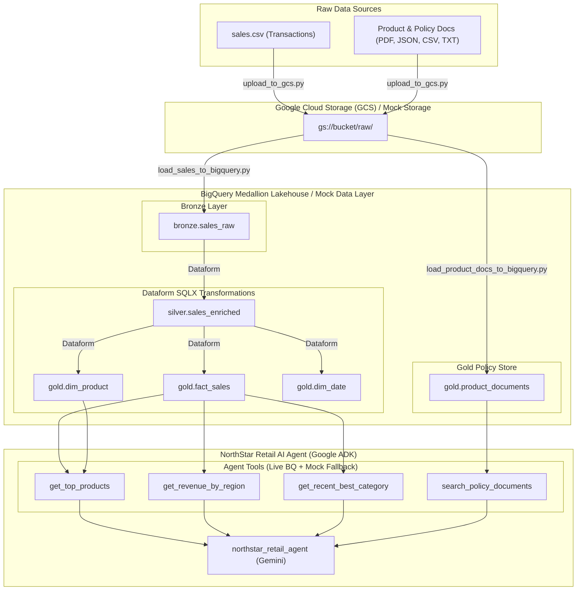

# NorthStar Retail - GCP Data Warehouse & GenAI Retail Assistant

A production-grade, end-to-end cloud data pipeline and conversational AI assistant built on Google Cloud Platform (GCP), Dataform, BigQuery, and Google Agent Development Kit (ADK) powered by Gemini.

> [!NOTE]
> **Zero-Credential / Mock Execution Support**: Where live GCP services or credentials are not configured, the entire repository automatically supports end-to-end execution through built-in mock implementations. You can run all ingestion scripts, test suites, and agent tools locally without active GCP credentials by setting `USE_MOCK=true`.

---

## 🌟 Overview

The **NorthStar Retail** platform provides business stakeholders and store managers with instant, grounded answers to business intelligence and store policy inquiries.

The solution integrates:
1. **Cloud Storage Ingestion**: Automated ingestion of structured sales data and unstructured product/policy documents into Google Cloud Storage (GCS) with local fallback.
2. **Medallion Data Lakehouse (BigQuery & Dataform)**:
   - **Bronze Layer**: Raw transactional sales tables loaded directly from GCS (`bronze.sales_raw`).
   - **Silver Layer**: Cleaned, deduplicated, and validated data with data quality filters (`silver.sales_enriched`).
   - **Gold Layer**: Star schema consisting of dimensional (`dim_product`, `dim_date`) and fact (`fact_sales`) tables, alongside an unstructured document store (`product_documents`).
3. **Conversational Agent (Google ADK & Gemini)**:
   - Natural language business intelligence interface.
   - Grounded tool execution preventing LLM hallucinations.
   - Sales analytics tools querying the authoritative Gold layer.
   - Document search tools providing policy answers (returns, shipping, warranties, loyalty programs).
4. **Mock Execution Engine**: Built-in mock drivers for all GCP ingestion, querying, and document retrieval tasks enabling full evaluation offline.

---

## 🏗️ Architecture



---

## 📁 Repository Structure

```text
├── .env.example                               # Sample environment variables template
├── .gitignore                                 # Git ignore rules for virtual environments and secrets
├── requirements.txt                           # Python package dependencies
├── README.md                                  # Complete project documentation and setup guide
├── agent/                                     # Google ADK Conversational Agent
│   ├── __init__.py
│   ├── config.py                              # Agent configuration, table mappings, and mock flags
│   ├── agent.py                               # Root agent definition and prompt instructions
│   └── tools/
│       ├── __init__.py
│       ├── agent.py                           # Tools module root agent reference
│       ├── sales_tools.py                     # BigQuery Gold analytical query tools (with Mock fallback)
│       └── policy_tools.py                    # BigQuery policy document search tools (with Mock fallback)
├── data/                                      # Local source dataset (sales and policies)
│   ├── sales.csv                              # Historical sales transactions
│   └── product_docs/                          # Unstructured policy documents
│       ├── loyalty.json
│       ├── promotions.pdf
│       ├── returns.pdf
│       ├── shipping.json
│       ├── sizing.txt
│       ├── stationery-faq.csv
│       ├── support.pdf
│       └── warranty.pdf
├── dataform/                                  # Dataform Medallion transformation pipeline
│   ├── workflow_settings.yaml                 # Dataform project configuration
│   └── definitions/
│       ├── sources/
│       │   └── sales_source.sqlx              # Declaration for bronze.sales_raw
│       ├── silver/
│       │   └── sales_enriched.sqlx            # Data cleansing, casting, and validation
│       └── gold/
│           ├── fact_sales.sqlx                # Star schema sales fact table
│           ├── dim_product.sqlx               # Product dimension table
│           └── dim_date.sqlx                  # Date dimension table
├── src/
│   └── ingestion/                             # Data ingestion & GCP initialization scripts
│       ├── setup_gcp.py                       # GCS bucket provisioning (live + mock)
│       ├── upload_to_gcs.py                   # Local-to-GCS upload pipeline (live + mock)
│       ├── load_sales_to_bigquery.py          # Bronze sales BigQuery loader (live + mock)
│       └── load_product_docs_to_bigquery.py   # Multi-format document parser & loader (live + mock)
└── tests/
    └── test_mock_pipeline.py                  # Automated test suite for zero-credential mock execution
```

---

## ⚙️ Prerequisites

- **Python**: Version `3.11` or higher.
- **Google Cloud Platform (GCP)** Account (Optional if running in Mock Mode).
- **GCP APIs Enabled** (for live mode):
  - BigQuery API (`bigquery.googleapis.com`)
  - Cloud Storage API (`storage.googleapis.com`)
  - Dataform API (`dataform.googleapis.com`)
- **Gemini API Key**: Obtainable from [Google AI Studio](https://aistudio.google.com/app/apikey) for conversational agent execution.

---

## 🚀 Step-by-Step Setup & Execution Guide

### Step 1: Clone the Repository and Navigate to Root

```bash
git clone https://github.com/surya241022/gcp-assessment-v1--A-Surya-Teja-Reddy-.git
cd gcp-assessment-v1--A-Surya-Teja-Reddy-
```

---

### Step 2: Create and Activate a Virtual Environment

**On Windows (PowerShell):**
```powershell
python -m venv .venv
.\.venv\Scripts\Activate.ps1
```

**On Linux / macOS:**
```bash
python3 -m venv .venv
source .venv/bin/activate
```

---

### Step 3: Install Dependencies

```bash
pip install -r requirements.txt
```

---

### Step 4: Configure Environment Variables

1. Copy the sample environment file:
   ```bash
   cp .env.example .env
   ```
2. Open `.env` and configure your settings:
   ```env
   # Google Cloud Platform Configuration
   GCP_PROJECT_ID=your-gcp-project-id
   GCP_REGION=asia-south1
   GCS_BUCKET_NAME=your-gcs-bucket-name
   BQ_LOCATION=asia-south1

   # BigQuery Datasets
   BQ_DATASET_ID=bronze
   GOLD_DATASET=gold

   # BigQuery Gold Tables
   FACT_SALES_TABLE=fact_sales
   DIM_PRODUCT_TABLE=dim_product
   DIM_DATE_TABLE=dim_date
   DOCUMENT_TABLE=product_documents

   # Mock Mode (Set to "true" to run without active GCP credentials)
   USE_MOCK=false

   # Gemini API Key (from Google AI Studio)
   GEMINI_API_KEY=your-gemini-api-key
   ```

---

### Step 5: Authenticate with Google Cloud (Skip if running in Mock Mode)

Authenticate your local environment using Application Default Credentials (ADC):

```bash
gcloud auth application-default login
gcloud config set project your-gcp-project-id
```

---

### Step 6: Provision GCS Bucket and Ingest Raw Data

1. **Create the Cloud Storage Bucket**:
   ```bash
   python src/ingestion/setup_gcp.py
   ```
   *(In Mock Mode or when credentials are absent, simulates bucket provisioning without error).*

2. **Upload Raw Sales CSV and Product Documents to GCS**:
   ```bash
   python src/ingestion/upload_to_gcs.py
   ```
   *(Uploads `data/sales.csv` and `data/product_docs/*` to `gs://<bucket>/raw/` preserving hierarchy).*

---

### Step 7: Ingest Data into BigQuery (Bronze & Gold Docs)

1. **Load Sales Data into BigQuery Bronze Layer (`bronze.sales_raw`)**:
   ```bash
   python src/ingestion/load_sales_to_bigquery.py
   ```

2. **Parse Multi-Format Policy Documents and Load into BigQuery (`gold.product_documents`)**:
   ```bash
   python src/ingestion/load_product_docs_to_bigquery.py
   ```
   *(Parses PDFs via `pypdf`, JSON files, TXT files, and CSV FAQs and indexes them into the Gold dataset).*

---

### Step 8: Execute Dataform Transformations (Silver & Gold Layers)

Transform raw Bronze data into clean Silver and Gold dimensional models.

#### Option A: Running via Google Cloud Console
1. Navigate to **Dataform** in Google Cloud Console.
2. Open your repository workspace.
3. Click **Start Execution** > **All Actions** (or select tags `silver` and `gold`).

#### Option B: Running via Dataform CLI
```bash
cd dataform
dataform run --tags silver,gold
cd ..
```

---

### Step 9: Launch the NorthStar Retail AI Assistant

Start the Google ADK web development server:

```bash
adk web
```

Open your browser and navigate to:
```text
http://127.0.0.1:8000
```
Select the **`northstar_retail_agent`** from the agent dropdown.

---

### Step 10: Run Automated Offline / Mock Tests

You can verify that all data tools, category aggregations, and policy document searches function end-to-end without live GCP credentials by running the automated unit test suite:

```bash
python -m unittest tests/test_mock_pipeline.py
```

---

## 💬 Sample Prompts & Verification

| Category | User Query | Expected Behavior / Tool Used |
| :--- | :--- | :--- |
| **Top Products** | *"What are the top 5 highest selling products by total revenue?"* | Calls `get_top_products(limit=5)` querying `fact_sales` & `dim_product`. |
| **Regional Sales** | *"Can you give me the total revenue breakdown across all regions?"* | Calls `get_revenue_by_region()` querying `fact_sales`. |
| **Recent Performance** | *"Which category generated the highest revenue in the 7 days prior to the latest recorded sale?"* | Calls `get_recent_best_category()` using the relative 7-day window. |
| **Return Policy** | *"What is the return policy for opened electronics?"* | Calls `search_policy_documents("returns")` on `gold.product_documents`. |
| **Warranty & Support** | *"How long is the standard warranty on stationery and appliances?"* | Calls `search_policy_documents("warranty")` on `gold.product_documents`. |
| **Shipping Fees** | *"What are the shipping charges for standard and express delivery?"* | Calls `search_policy_documents("shipping")` on `gold.product_documents`. |

---

## 🎯 Key Design Decisions & Architecture

1. **Strict Grounding & Anti-Hallucination**:
   - The LLM instructions explicitly prohibit guessing or querying unverified sources.
   - All sales analytics are routed to BigQuery Gold SQL aggregations (or validated local mock fact records).
   - All policy answers are sourced directly from ingested documentation in `gold.product_documents`.
2. **Medallion Data Architecture**:
   - **Bronze**: Exact raw data ingestion from GCS.
   - **Silver**: Deduplicated, type-casted (`NUMERIC`, `DATE`, `INT64`), null-filtered data.
   - **Gold**: High-performance Star Schema (`fact_sales`, `dim_product`, `dim_date`) optimized for analytical queries.
3. **Relative 7-Day Window for Category Analytics**:
   - Rather than relying on today's system date (which would yield no results for historical static datasets), `get_recent_best_category` dynamically calculates `MAX(date_key)` from `fact_sales` and computes performance across `[MAX(date_key) - 7, MAX(date_key))`.
4. **Multi-Format Document Extraction**:
   - `load_product_docs_to_bigquery.py` handles PDF, JSON, TXT, and CSV formats uniformly, producing clean, queryable text for semantic lookups.
5. **Zero-Dependency Mock Fallback**:
   - Ingestion scripts and agent query tools detect when live GCP credentials are unavailable and seamlessly switch to local parsing and analysis, ensuring the solution can be evaluated anywhere.

---

## ⚠️ Assumptions & Limitations

- **Dataset Recency**: Historical batch sales data is used; real-time streaming ingestion (e.g. Pub/Sub to BigQuery) can be added for live transaction streams.
- **Document Search**: Current document retrieval uses keyword pattern matching on BigQuery text columns; integration with Vertex AI Vector Search / Text Embeddings can be implemented for deeper semantic similarity at scale.
- **Authentication**: Live execution requires standard Google Cloud Application Default Credentials and a valid Gemini API key. Mock execution requires only the Gemini API key.

---

## 📄 License

This project is developed as part of the GCP assessment and is licensed under the MIT License.
